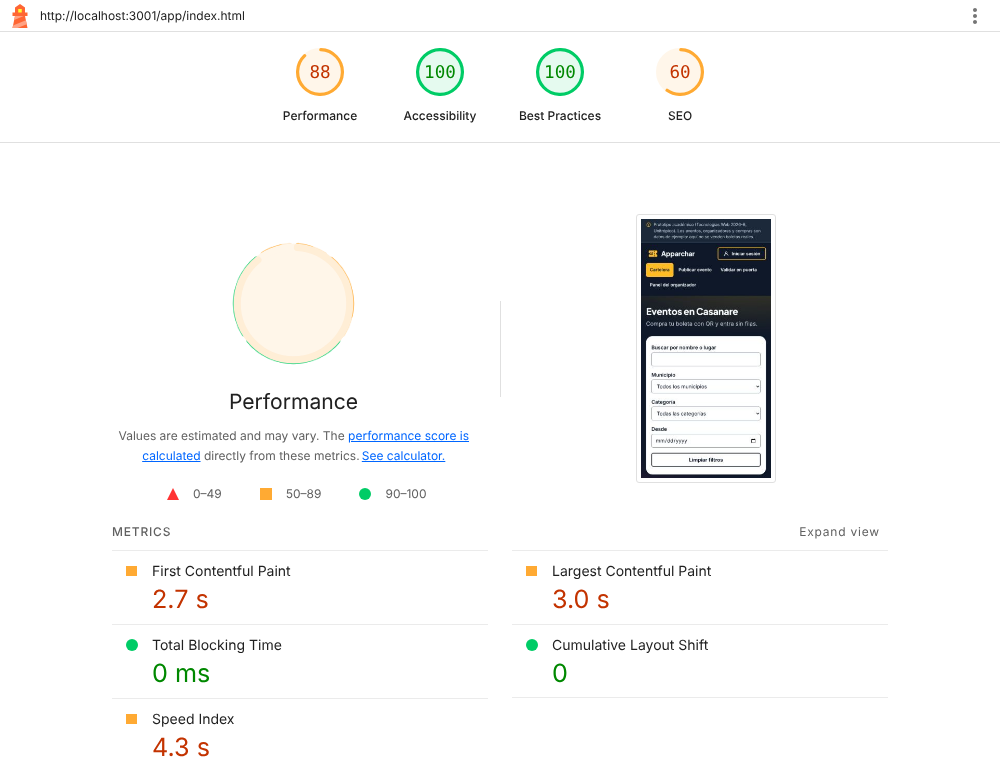
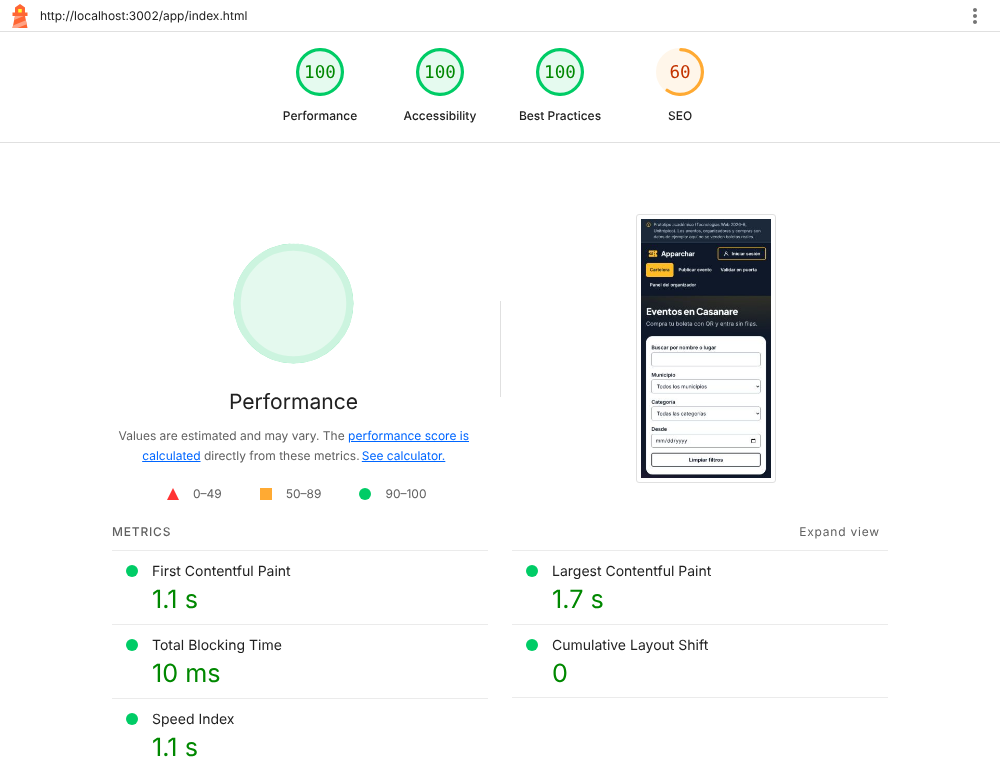

# Informe de rendimiento · Entrega 4

Mediciones de Lighthouse sobre la cartelera (`/app/index.html`), la página de
entrada de Apparchar, antes y después de optimizar. Las corridas usan el perfil
móvil por defecto de Lighthouse 13.5 (Moto G Power emulado, red 4G lenta
simulada y CPU ×4), con Chromium sin extensiones. Cada medición es la **mediana
de tres corridas**, porque una sola corrida varía varios puntos.

> **Estado de las mediciones.** La línea base y la medición posterior se
> tomaron el **11 de noviembre de 2026** sobre los contenedores de este
> repositorio, en una máquina limpia. Se midió la API sola y también a través
> del proxy del compose, que es lo mismo que sirve el VPS. Cuando quede publicada
> la URL pública, la medición posterior se repite sobre ella y se agrega en la
> sección «Medición sobre la URL pública».

## 1. Línea base

Versión `0.3.0` (rama `main` antes de esta entrega, commit `94fa53a`), servida
por la API con `express.static`, sin compresión y con las fuentes de Google Fonts.



| Categoría | Puntuación |
|---|---:|
| Rendimiento | **87** |
| Accesibilidad | 100 |
| Buenas prácticas | 100 |
| SEO | 60 |

| Métrica | Valor |
|---|---:|
| First Contentful Paint (FCP) | 2,75 s |
| Largest Contentful Paint (LCP) | 3,05 s |
| Speed Index | 4,34 s |
| Total Blocking Time | 0 ms |
| Cumulative Layout Shift | 0 |
| Peso total transferido | 272 KB |

## 2. Diagnóstico

El LCP no lo arrastra una imagen ni el JavaScript, sino **el texto del aviso de
la cabecera** (`header.cabecera > p.aviso-prototipo > span`). Lighthouse lo
descompone así: 11 ms de tiempo hasta el primer byte y **2.321 ms de retraso de
pintado**. El texto está en el HTML desde el principio; lo que retrasa el
pintado son dos hojas de estilos que bloquean el renderizado:

| Recurso que bloquea | Qué pasaba | Tiempo bloqueado |
|---|---|---:|
| `https://fonts.googleapis.com/css2?family=Inter…&family=Plus+Jakarta+Sans…` | Hoja de estilos en **otro origen**: DNS, TLS y una ida y vuelta más antes de saber qué fuentes descargar, y después otra conexión a `fonts.gstatic.com` por los dos `.woff2` (48 KB y 27 KB). Es la cadena crítica más larga de la página. | 884 ms |
| `web/css/estilos.css` | 49 KB **sin comprimir**. | 903 ms |

Lo demás que reportó la herramienta, en orden de impacto:

- **Sin compresión de texto** en el documento, el CSS, el JavaScript
  (`web/js/app.js`, 84 KB) y los datos (`web/datos/ejemplo.json`, 48 KB).
- **CSS y JS sin usar o sin minificar** (34 KB y 59 KB estimados): la página
  carga el `estilos.css` y el `app.js` de todo el prototipo.
- **SEO en 60** por un único motivo: `<meta name="robots" content="noindex">`.

## 3. Intervenciones

En este orden, de mayor a menor impacto esperado sobre el LCP:

1. **Fuentes servidas desde el propio sitio.** Inter y Plus Jakarta Sans pasan a
   `web/fuentes/` (licencia SIL OFL 1.1, versión variable y solo el subconjunto
   latino) con `@font-face` y `font-display: swap` al inicio de `estilos.css`, y
   `<link rel="preload">` de Inter en las cinco páginas. Se eliminan los dos
   orígenes externos y la hoja de estilos de Google que bloqueaba el pintado:
   el texto se pinta en cuanto llega `estilos.css`.
   *Por qué primero:* era la cadena crítica más larga y dependía de dos
   conexiones nuevas, el costo más alto en una red móvil.
2. **Compresión de texto.** `compression` en Express (`servidor/app.js`) para
   Render, donde la API recibe el tráfico directamente, y `encode zstd gzip` en
   Caddy (`proxy/Caddyfile`) para el compose. Caddy no vuelve a comprimir lo que
   ya llega comprimido. Con gzip, `estilos.css` baja de 50 KB a 10 KB y
   `app.js`, de 84 KB a 22 KB.
   *Por qué:* reduce el tiempo de descarga del único CSS que queda bloqueando y
   del JavaScript, sin tocar el código.
3. **Caché del navegador** según el tipo de archivo: 30 días e `immutable` para
   fuentes e imágenes, 1 hora para CSS, JS y JSON, y revalidación del HTML en
   cada visita. Así, un despliegue nuevo se ve de inmediato.
   *Por qué:* no cambia la primera visita que mide Lighthouse, pero sí las
   siguientes: la cartelera vuelve a cargar solo el HTML.
4. **Sin saltos de diseño.** Al medir las cinco páginas apareció un problema que
   la cartelera no tenía: en la validación en la puerta (`puerta.html`) el CLS
   era de **0,51** y el rendimiento, de **79**. La traza de Lighthouse mostró
   dos saltos:
   - El título cambiaba de tamaño cuando llegaba Plus Jakarta Sans, que no se
     precargaba.
   - El bloque «Cargando…» tenía otro margen y otro alto que el formulario que lo
     reemplaza, así que el formulario saltaba 24 px.

   Se precargan las dos fuentes en las cinco páginas, y `.estado-puerta` ocupa el
   mismo lugar y alto que la rejilla (`web/css/estilos.css`). Resultado: CLS 0 y
   rendimiento 100 en esa página.

## 4. Medición posterior

Misma página, misma configuración de Lighthouse, con las tres intervenciones.



| Indicador | Antes | Después | Cambio |
|---|---:|---:|---:|
| **Rendimiento** | 87 | **100** | +13 |
| Accesibilidad | 100 | 100 | = |
| Buenas prácticas | 100 | 100 | = |
| SEO | 60 | 60 | = |
| FCP | 2,75 s | **1,07 s** | −61 % |
| LCP | 3,05 s | **1,66 s** | −46 % |
| Speed Index | 4,34 s | **1,07 s** | −75 % |
| Total Blocking Time | 0 ms | 12 ms | +12 ms |
| CLS | 0 | 0 | = |
| Peso total transferido | 272 KB | **125 KB** | −54 % |

A través del proxy del compose (Caddy con zstd) el resultado es el mismo:
rendimiento 100, FCP 1,07 s, LCP 1,64 s y 125 KB.

**Las cinco páginas**, a través del proxy, con las cuatro intervenciones
(mediana de tres corridas, 11 de noviembre de 2026):

| Página | Rendimiento | Accesibilidad | Buenas prácticas | LCP | CLS |
|---|---:|---:|---:|---:|---:|
| Cartelera (`index.html`) | 100 | 100 | 100 | 1,67 s | 0 |
| Panel del organizador (`panel.html`) | 100 | 97 → **100** con el #7 | 100 | 1,67 s | 0,02 |
| Detalle y compra (`detalle.html`) | 98 | 100 | 100 | 1,51 s | 0,09 |
| Publicar evento (`publicar.html`) | 100 | 100 | 100 | 1,58 s | 0 |
| Validar en la puerta (`puerta.html`) | 79 → **100** | 100 | 100 | 1,51 s | 0,51 → **0** |

El 97 del panel es el contraste del texto bajo el título, que corrige el pull
request #7. Con los dos integrados, las cinco páginas quedan en 100 de
accesibilidad.

**Qué quedó pendiente y por qué:**

- **SEO en 60.** Se mantiene a propósito: la página publica eventos y
  organizadores de ejemplo de un prototipo académico, así que no debe aparecer
  en los buscadores. Si Apparchar pasa a datos reales, basta con quitar la
  etiqueta `noindex` de las cinco páginas.
- **CSS y JS sin usar o sin minificar.** Partir `estilos.css` y `app.js` por
  página y minificarlos exige una etapa de construcción (por ejemplo, Vite o
  esbuild) que el proyecto no tiene. Con la compresión, el ahorro restante es de
  unos 20 KB y ya no aparece entre los recursos que bloquean.
- **Los 12 ms de Total Blocking Time** salen de evaluar `app.js` una vez que la
  página ya pintó, y están muy por debajo del umbral de 200 ms.
- **La red hasta el servidor.** En la URL pública se suma la latencia hasta el
  VPS y el HTTPS. En el VPS no hay arranque en frío: los servicios están
  siempre encendidos. En la alternativa de Render sí lo hay: el plan gratuito
  apaga el servicio a los 15 minutos sin tráfico.

## 5. Medición sobre la URL pública

*Pendiente:* se agrega al quedar instalado el proyecto en el VPS, con la misma
metodología (mediana de tres corridas, perfil móvil) y la fecha de la corrida.

## Cómo repetir la medición

```bash
docker compose up -d --wait             # el conjunto en http://localhost:8080
npx lighthouse@13.5.0 http://localhost:8080/app/index.html \
  --only-categories=performance,accessibility,best-practices,seo \
  --output=html --output-path=./reportes/cartelera.html --view
```

O, en Chrome: DevTools → Lighthouse → modo «Navegación», dispositivo
«Móvil», las cuatro categorías.
